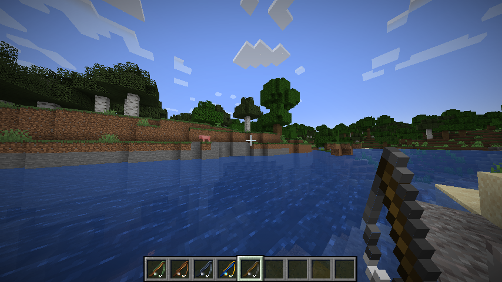
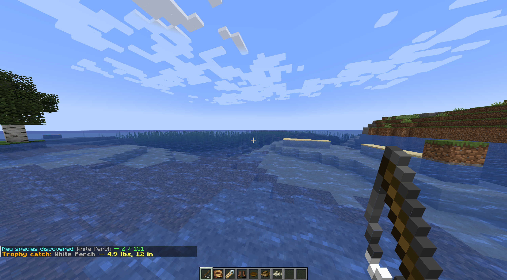
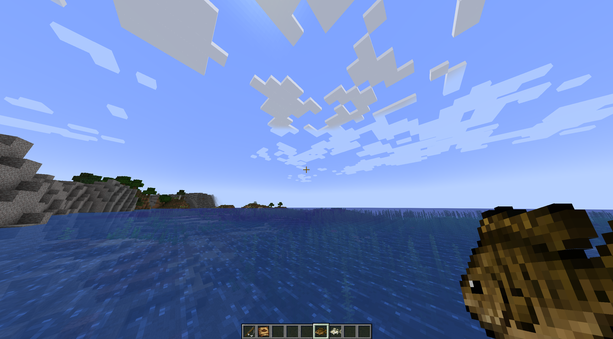

# Angler's Odyssey

Angler's Odyssey is a cozy, collection-focused fishing adventure for Fabric 1.20.1 through 1.21.11. Cast into rivers, lakes, oceans, and other habitats to discover 151 fish, chase shiny variants, land trophy catches, and work your way through four custom rod tiers.

[](https://fabricmc.net/)
[](https://fabricmc.net/)
[](https://github.com/grubbs-dev/anglers-odyssey/releases)

## Screenshots

<p align="center">
  
  
</p>

<p align="center">
  
</p>

## What makes it fun

- Explore a large fish catalogue with rarity tiers, habitat restrictions, shiny variants, weights, lengths, and personal records.
- Build a collection in the Angler's Journal and follow the Angler's Odyssey advancement path.
- Unlock stronger rods as you discover species, each with a custom fishing bonus alongside vanilla rod enchantments.
- Find trophy catches and celebrate new species with in-game announcements.

## Installation

1. Install one of the supported Minecraft releases with Fabric Loader.
2. Install the matching Fabric API version.
3. Place the JAR matching your exact Minecraft version in the instance's `mods` folder.
4. Launch the Fabric profile and fish with a vanilla or Angler's Odyssey rod.

Available artifacts are listed in `docs/compatibility/release-matrix-1.20.x.md` and `docs/compatibility/release-matrix-1.21.x.md`. Do not use a JAR from another Minecraft version.

The mod is designed for both client and dedicated-server play. Install the same mod and Fabric API versions on the server and every client.

## Controls

- Right-click with a fishing rod to cast.
- Right-click again to reel in.
- Hold the Angler's Journal and right-click to open it.
- Use the journal's Previous and Next buttons to browse fish records, statistics, and rod progression.

## Rod progression

Discover new fish species to earn stronger rods. Rod abilities are custom to Angler's Odyssey and do not replace normal vanilla enchantments; all four rods remain compatible with vanilla fishing-rod enchantments.

| Rod | Unlock | Durability | Custom ability |
| --- | ---: | ---: | --- |
| Reed Rod | 20 species | 64 | Steady Grip |
| Oak Rod | 50 species | 128 | Quick Set — faster bites |
| Ironwood Rod | 100 species | 192 | Treasure Sense — better treasure odds |
| Angler's Rod | 150 species | 256 | Master Angler — faster bites and better treasure |

The Angler's Journal is crafted shapelessly from one vanilla book and one fish from the mod's fish tag.

## Development setup

The project targets Java 17 bytecode. The current Fabric Loom toolchain requires Java 21 or newer to run; Java 25 is also supported. A local development runtime is stored under `.tools/` and is ignored by Git.

From PowerShell:

```powershell
.\dev.ps1 build
.\dev.ps1 runClient
```

The first build downloads the Gradle and Fabric dependencies. The dev client uses the `run/` directory for its local Minecraft instance.

## Release build

Run the build with explicit version properties, for example `./gradlew.bat clean build -Pminecraft_version=1.21.11 -Pyarn_mappings=1.21.11+build.6 -Ploader_version=0.19.5 -Pfabric_api_version=0.141.6+1.21.11 -Pmod_version=1.2.11 -Pjava_version=21`. The distributable JAR is written with both mod and Minecraft versions in its name; the sources JAR is not required for player installation.

## Project structure

- `src/main/java` and adapter source sets — shared logic plus isolated Minecraft API integrations
- `src/client/java` and versioned client adapter source sets — journal UI, rendering, and client initialization
- versioned resources — loot tables, advancements, recipes, and biome region tags
- `docs/fish_tables` — fish reference tables by rarity

## Asset note

The rod art follows the vanilla Minecraft fishing-rod pixel silhouette and uses Angler's Odyssey recolors, including separate held and cast-state textures. Review Mojang/Microsoft's current asset and distribution terms before publishing a public release.

## License

This project is licensed under the terms in [LICENSE](LICENSE).
